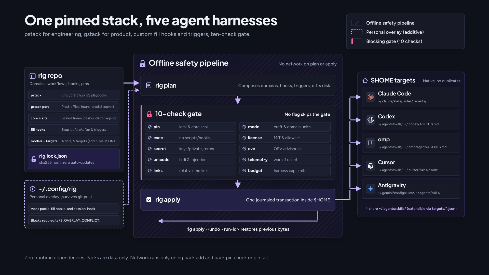

# rig

[](https://github.com/rigyard/rig/actions/workflows/test.yml)
[](./LICENSE)


Stop maintaining separate agent setups for Claude Code, Codex, omp, Cursor, and Antigravity. rig compiles one Git-pinned stack of skills, workflows, hooks, triggers, and model tiers into every coding-agent harness on your machine, with a read-only diff, a ten-check safety gate, and one-command rollback.



## Why use rig

- **Engineering (`pstack`) and product (`gstack`) built in.** `/craft` compiles `packs/pstack` (hub and 22 playbooks) for engineering and `packs/product` (`office-hours` ported from `gstack`) for `prod:discover`, leaving `biz:*` and `prod:*` slots open for your own packs.
- **Custom hooks and triggers without pack code.** Wire skills into stage slots (`eng:design`), `.before`/`.after` step hooks (`eng:ship.before`), domain triggers, and always-on frame triggers in `rig.json` or `~/.config/rig`.
- **Write once, extend as data.** Add a unit once and rig writes each harness's native format with zero duplicate listings across `~/.agents/skills/`. Add more harnesses such as `pi` as records in `targets/`.
- **Pinned copies, offline gate, instant undo.** Packs are data pinned by commit SHA and sha256 tree hash in `rig.lock.json`, ten checks block secrets, executables, broken links, and cap overruns, and `rig apply --undo <run-id>` restores any run byte for byte.

## Get started

Requires Node 22.18.0 or later. rig has no runtime dependencies and no build step.

### With your coding agent

No checkout yet? Paste this into any coding agent:

```text
Set up rig: follow https://raw.githubusercontent.com/rigyard/rig/main/AGENTS.md
```

Already cloned? Open the checkout in your agent and say:

```text
Set up rig.
```

The agent runs `rig doctor` and `rig plan`, explains the diff, and runs `rig apply` only after you approve.

### By hand

```sh
git clone https://github.com/rigyard/rig.git ~/src/rig
cd ~/src/rig
npm link
rig doctor
rig plan
rig apply
```

`rig doctor` and `rig plan` write nothing. To use fewer than five harnesses, edit `harnesses` in `rig.json` before `rig apply`. If Homebrew `rig` is already on `PATH`, use `rigctl`.

## What ships out of the box

- **Default stack.** Pinned `/craft` workflow (`packs/pstack`), `office-hours` product discovery (`packs/product`), `cursor-team-kit`, `cli-for-agents`, and a sealed core (`packs/core`) across Claude Code, Codex, omp, Cursor, and Antigravity.
- **Seven commands.** `rig doctor`, `rig plan`, `rig apply`, `rig models`, `rig stats`, `rig pack`, and `rig pin`. Every command takes `--help`, and full flags live in [the CLI and repository reference](./docs/reference.md).
- **Personal overlay.** Keep private packs, extra `fill` hooks and triggers, and `metrics.session_hook` in `~/.config/rig` so `git pull` leaves your setup alone ([Make it yours](./docs/guide/09-make-it-yours.md)).

## Documentation

- [AGENTS.md](./AGENTS.md) tells your coding agent how to set up and use rig.
- [The rig guide](./docs/guide/README.md) walks through setup, the gate, packs, `/craft`, hooks, models, and overlays.
- [CLI and repository reference](./docs/reference.md) holds domains, hooks, commands, harness paths, shipped packs, and safety checks.
- [What rig writes per harness](./docs/harnesses.md) lists every path rig touches and every path it refuses to write.
- [Design, ADRs, and architecture](./docs/README.md) and [evaluations](./evals/README.md) document how rig is built and tested.
- [Contributing](./CONTRIBUTING.md), [Security](./SECURITY.md), [MIT License](./LICENSE), and [Third-party notices](./NOTICE.md).
